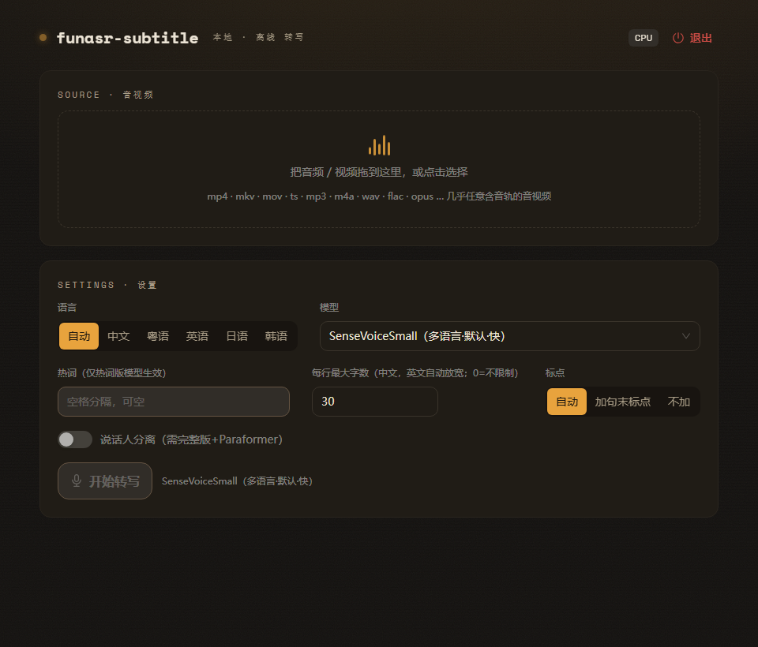

<div align="center">

# funasr-subtitle

纯本地离线，音视频直接出带时间戳字幕，中文粤语强于 Whisper

[](LICENSE)
[](https://github.com/rockbenben/funasr-subtitle/actions/workflows/ci.yml)
[](https://github.com/rockbenben/365opensource)

**[⬇ 下载最新版](https://github.com/rockbenben/funasr-subtitle/releases/latest)** —— Windows x64 便携包，解压双击即用

把音频或视频（mp4 / mkv / mp3 / m4a / wav …）丢进去，得到带时间戳的多语言字幕（SRT / VTT / TXT / JSON）。
基于 [FunASR](https://github.com/modelscope/FunASR) 的 ONNX 推理；FunASR 模型针对中文场景训练，**中文 / 粤语**表现通常优于通用的 Whisper。

[下载](#-下载) · [使用](#-使用) · [实时转写](#️-实时转写) · [工作原理](#️-工作原理) · [开发](#️-开发)

<br>



</div>

---

得益于 FunASR 的**非自回归** ASR 模型（不像 Whisper 那样逐 token 解码），纯 CPU 也能跑得很快，**最适合快速生成中 / 日 / 英字幕**。首次联网下载模型后**完全离线可用**，不上传任何音视频。输出的 `.srt` 可直接喂给 **[subtitle-translator](https://tools.newzone.top/zh/subtitle-translator)** 做翻译——本工具本身不做翻译。

## 目录

- [funasr-subtitle](#funasr-subtitle)
  - [目录](#目录)
  - [✨ 特性](#-特性)
  - [📦 下载](#-下载)
  - [🚀 使用](#-使用)
    - [🎙️ 实时转写](#️-实时转写)
  - [⚙️ 工作原理](#️-工作原理)
  - [⚠️ 已知局限](#️-已知局限)
  - [🛠️ 开发](#️-开发)
  - [📄 License](#-license)
  - [关于 365 开源计划](#关于-365-开源计划)

> 关键词：本地字幕生成 · 离线语音转文字 · 音视频转写 · speech-to-text · FunASR · SenseVoice · Paraformer · 中文 · 粤语 · 方言 · Windows · SRT 字幕

## ✨ 特性

- 🔒 **纯本地 / 离线** — 除首次下载模型外不联网，不上传任何音视频。
- 🖥️ **Windows 便携包** — 解压 → 双击 `funasr-subtitle.exe` → 浏览器里用；无需安装、无需管理员权限、无需预装 Python。
- ⚡ **纯 CPU·够快** — 默认 SenseVoiceSmall（**非自回归** + 量化 ONNX）。实测整条管线（VAD + ASR + 切句）RTF ≈ 0.1（约 10× 实时，10s 音频 ~1s 出字幕；ASR 推理本身更快，RTF ≈ 0.02）。非自回归是它比逐 token 解码的 Whisper 快得多的根本原因。
- 🎯 **多模型可选** — SenseVoiceSmall（快·多语言）/ Paraformer-zh（中文高精度）/ Paraformer-zh 热词版（支持热词）。
- 🌐 **多语言** — 中文 / 粤语 / 英语 / 日语 / 韩语，可自动识别或手动指定。
- 🎙️ **实时转写** — 麦克风收录线下课堂，或共享网课标签页／电脑声音，边说边出字。复用上游 Paraformer 在线模型，CPU 包与完整版均可用；实时模式目前只支持中文，首次需单独下载模型。
- ✂️ **专业字幕切分** — 按标点 / 停顿切句；每行「显示宽度」可调（中日韩字符算 1、拉丁/数字算 0.5，默认 30 ≈ 中文 30 字 / 英文 ~60 字，上限 100，`0` = 不限制）+ 单条 ≤ 7s，断点取 句末 > 子句 > 词边界，不拆英文词；最终 cue 严格单调不重叠。
- ⏸️ **按停顿断句（可选）** — 「停顿超过几毫秒就断」填上（如 `300`）后，说话停顿超过该长度的位置会被优先选作断行点：一句话说完一停，正好断成两行，而不是按字数硬切在 `10+2` 这种位置。默认 `0`（不启用）。实现用的是**上游 VAD 的静音阈值**，所有模型/后端一视同仁；代价是断成两段后每段单独转写、单独加标点，段末的逗号可能变成句号。
- 🔢 **数字规范化可选** — 「数字转阿拉伯数字」默认开着：说话里的「二零二五年」写成 `2025年`、「十五台」写成 `15台`；带量词的（「三个苹果」）不动。关掉就保留中文数字原样。
- 🔤 **标点模式可选** — `自动`（默认：中文等自带标点的语言加句末标点；**英文按停顿切、不强加**——英文模型标点常不准，错位句号会把一句切碎）/ `加标点` / `不加标点`。
- 📝 **多格式导出** — SRT / VTT / TXT / JSON，或一键「复制全文」。拿得到逐字时间戳的模型，JSON 里会带每个字的起止毫秒（`words`），可以直接拿去做卡拉OK / 逐词高亮；拿不到的路径不带这个字段（见「已知局限」）。
- 👥 **说话人分离（可选）** — 用 cam++ 标注每段说话人，导出含 `[spk0]`/`[spk1]`…；**仅完整版 + Paraformer 模型**可用（完整版有 N 卡且随包内核支持就自动用 GPU，否则回退 CPU）；onnx 版与 SenseVoice 不支持。cam++ 不在首启下载清单里，勾上这个开关后首次转写时才现下（量不大，但第一次会多等一会儿）。

## 📦 下载

**不确定选哪个？下 `funasr-subtitle-win-x64.zip`（CPU 包，约 372 MB），绝大多数人够用。**

前往 **[Releases](https://github.com/rockbenben/funasr-subtitle/releases/latest)** 下载 Windows x64 便携包，解压 → 双击 `funasr-subtitle.exe` → 浏览器里用。两份**界面与操作完全一样**，差的是推理后端（连模型都是两套：CPU 包用 onnx 权重，完整版用 pt 权重）：

| 包                                   | 大小    | 后端                 | 适用                                                                          |
| ------------------------------------ | ------- | -------------------- | ----------------------------------------------------------------------------- |
| **funasr-subtitle-win-x64.zip**      | ~372 MB | funasr-onnx · 纯 CPU | 绝大多数人首选（RTF ≈ 0.1，无需显卡）                                         |
| **funasr-subtitle-cuda-win-x64.zip** | 数 GB | 完整 funasr · torch  | 有 N 卡且随包内核支持就自动 GPU 加速，否则回退 CPU；要说话人分离 / Paraformer 高精度 / 大模型 |

> [!NOTE]
> 首次运行需联网下载模型（CPU 包默认 SenseVoice ≈ 235 MB；完整版用 pt 模型，SenseVoice ≈ 0.9 GB，Paraformer-zh ≈ 2.1 GB），之后离线可用。程序未签名，SmartScreen 提示时点「更多信息」→「仍要运行」。

> [!IMPORTANT]
> **CUDA 包超过 GitHub 单文件 2 GB 上限**，所以拆成多个分卷：下载该版本的全部 `…cuda-win-x64.zip.001`、`.002`、……放同一目录，双击随附的 `funasr-subtitle-cuda-win-x64-merge.bat` 合并出完整 zip，再解压。CPU 包无需此步。

## 🚀 使用

**解压 → 双击 `funasr-subtitle.exe` → 把音视频拖进页面 → 点「开始转写」。**

1. **第一次打开：先下模型。** 页面会提示「先下模型」，点「下载模型」，等提示「模型已就绪」；之后完全离线。默认模型 CPU 包约 235 MB（完整版约 0.9–2.1 GB）。
2. **转写：拖文件，点开始。** 把 mp4 / mkv / mp3 / wav 拖进页面 → 点「开始转写」。语言默认「自动」，模型用默认的就行；热词 / 每行字数 / 标点这些不填也能用。
3. **导出：点 `.srt`。** 结果出来后点「.srt」下载，文件会存到浏览器的下载目录，名字和源文件一样（`a.mp4` → `a.srt`）。也可以选 `.vtt` / `.txt` / `.json`，或「复制全文」。
4. **退出：** 点页面右上角「停止服务」，或右下角托盘图标。退出会清掉当前字幕，**先导出再退**。

### 🎙️ 实时转写

在「声音来源」里选「麦克风 · 实时」（线下课堂）或「电脑声音 · 实时」（网课），先下载下方模型列表里的「Paraformer 实时版（中文）」（CPU 包约 228 MB，完整版约 849 MB），再点「开始实时转写」。这是**单独一套在线模型**，和文件转写的模型不通用；没下载就开始会提示先下载。麦克风需要允许收音；电脑声音推荐用 Chrome / Edge，在共享弹窗中选网课标签页或屏幕，并勾选「共享音频」。能否共享声音取决于浏览器、系统和所选来源，没有音轨时页面会提示重选。

实时字幕以歌词式大字显示，突出当前句、保留最近的上文。点「悬浮显示」会直接申请独立字幕小窗：优先用浏览器画中画（Document Picture-in-Picture）置顶，其次普通窗口；只有浏览器两种都给不了时，才回退页面内小窗并提示原因。小窗和主页面共用同一份字幕状态，随转写同步更新，也能停止收音；关闭小窗不影响转写，完整字幕仍在主页面。

点「停止收音」后会补完尾字，可导出相同的四种格式。保持主页面打开；录音本身不会保存。实时模式**只支持中文**，暂不加标点、不区分说话人，时间按收音块估算，JSON 不含逐字时间戳；需要精确对轴时，请使用文件转写。实时转写期间不能再转写文件，反之亦然。模型和技术接口见 [引擎文档 §9](backend/app/engine/README.md#9-实时转写)。

> **「已下载」按后端各算各的**：CPU 包认 onnx 权重，完整版认 pt 权重（ASR + VAD，不自带标点的模型再加 ct-punc）。同一台机器换另一个包跑，两边的「已下载」状态互不相干。万一没先点「下载模型」就开始转写，后端也会在任务里现下模型——这时进度条会长时间停在「读音频」，属正常，等模型下完就跑起来了。

> 想用命令行：按 [开发](#️-开发) 装好依赖后，`cd backend`，运行 `.\.venv\Scripts\python -m app.engine.cli "C:\video\a.mp4" -o "C:\video\a.srt"`。（完整版的依赖装在 `backend\.venv-full` 里，把上面路径换成它即可。）界面上的设置命令行都有同名开关：`--max-chars`（每行几个字）、`--pause-ms`（停顿多少毫秒就断）、`--no-itn`（数字保留中文原样）、`--punctuation auto|on|off`、`--hotwords "..."`。

## ⚙️ 工作原理

```text
[默认浏览器 UI] ⟷ http://127.0.0.1:<port> ⟷ [本地 FastAPI 服务]
   React SPA          REST + WebSocket          ├─ ffmpeg 解码 → 16k 单声道
                                                 ├─ VAD(fsmn) 切出语音段
                                                 ├─ ASR(SenseVoice / Paraformer)
                                                 ├─ 标点（按模式：中文加 / 英文按停顿）
                                                 └─ 按标点 / 停顿切自然语句 + 时间戳
```

- **VAD** 圈出「哪里在说话」，**ASR** 出文字，**切句** 决定字幕断行——三件事各司其职。
- **「按停顿断句」用的是上游 VAD 的静音阈值**：说话停下来的地方本来就会被 VAD 切成新的语音段，
  我们只是把这个阈值调小（上游参数），不改任何模型逻辑。
- **时间戳**：SenseVoice 由 CTC 帧位置推出逐 token 时间（onnx 包），完整版直接用上游的逐字时间戳（`output_timestamp`）；Paraformer 在 full 包给句级时间戳、在 onnx 包按 VAD 段比例分配。拿到逐字时间戳的路径，JSON 导出里还会带上每个字的起止毫秒。
- 上图是 **CPU 包（onnx）** 的管线。完整版把 VAD+ASR+标点合成 funasr 的一次 `generate()`，
  内部多步自己走，界面看到的阶段是一样的。
- 两套后端**连模型都不是同一批**（onnx 权重 vs pt 权重），体积差一到两个数量级。
- 上图只画**文件转写**。实时转写走另一套在线模型：浏览器 AudioWorklet 出 16k PCM → `/ws/live` → 上游 Paraformer-online 流式推理，不经 ffmpeg / VAD / 标点，详见 [引擎文档 §9](./backend/app/engine/README.md#9-实时转写)。
- 各模型 / 后端的实测结论详见 [`backend/app/engine/README.md`](./backend/app/engine/README.md)。

## ⚠️ 已知局限

- **英文默认不强加句末标点** — SenseVoice / ct-punc 的英文句末标点常不准，错位的句号会把一句切碎。因此「标点」默认 `自动` 时**英文走「按停顿」**：去掉句末 `.?!`（逗号 / 小数保留），只按语音停顿 + 行宽在词边界切，断行干净但没有完整书面句号。需要书面句标点可把「标点」切到 `加标点`（用 SenseVoice 自带标点，已处理 `e.g.`/`U.S.`/`Inc.` 缩写）。**中文 / 日文自带标点较准，默认自动加，不受影响。**
- **完整版首次要下 GB 级模型** — pt 权重 SenseVoice ≈ 0.9 GB、Paraformer-zh ≈ 2.1 GB（含 ct-punc），第一次转写前就得下完；磁盘和网速都要留够。
- **逐字时间戳只覆盖部分路径** — SenseVoice（两条后端都算）能给出每个字的起止毫秒，JSON 导出里带 `words`，够做卡拉OK / 逐词高亮；**onnx 的 Paraformer 拿不到字级时间**（导出的 ONNX 只有 `logits`+`token_num`，没有 CIF peaks），那条路的 `words` 是空的，时间戳只到句级；**实时转写的在线模型同样没有逐字时间**，JSON 里也不带 `words`。
- **实时转写是中文专用** — 目前只有 Paraformer 在线模型（中文），且不加标点、不区分说话人，时间按收音块估算而非逐字对轴；「声音来源」里的实时选项和文件转写互斥。
- **未签名** — Windows SmartScreen 会拦，需手动「更多信息」→「仍要运行」。

## 🛠️ 开发

**环境**：Windows · Python 3.11（`pyproject.toml` 钉的是 `>=3.11,<3.12`）· Node 24（CI 跑的就是 24；`npm run test:live` 直接 import `.ts`，要 Node ≥22.6 的类型剥离支持）

```powershell
# 后端：建 venv + 装依赖（只需一次）
#   [dev] = pytest/httpx/ruff；[onnx] = funasr-onnx 推理栈（几百 MB）
py -3.11 -m venv backend\.venv
backend\.venv\Scripts\python -m pip install -e "backend[dev,onnx]"

# 起后端
cd backend; ..\backend\.venv\Scripts\python -m uvicorn app.main:app --reload --port 8765

# 前端
cd frontend; npm ci; npm run dev
```

> **开发完整版（full）**：另建一个 venv 装 torch + `backend\requirements-full.txt`（见该文件头部注释），然后用 `FUNASR_SUBTITLE_BACKEND=full` 起后端。默认（不设这个变量）走 onnx 后端——构建期烘焙的值只影响打包产物，开发态永远是 onnx。

> **模型缓存位置**：默认 `%LOCALAPPDATA%\funasr-subtitle\models`。设了 `MODELSCOPE_CACHE` 就改用它（funasr 也读同一个变量），两边不会各存一份。测试会显式清掉这个变量，保证跑在临时目录里，不碰你真实的模型缓存。

> **关于 DirectML 显卡加速**：`onnxruntime-directml` 和 `funasr-onnx` 依赖的纯 CPU 版 `onnxruntime` 提供同名包、会互相覆盖，pip 保证不了 DirectML 胜出；而且实测 DirectML 对量化 ONNX 模型反而**慢 ~2.8×**，所以前端已隐藏该开关（`App.tsx` 里 `useGpu = false`），依赖里也就没列它。真想手动试的话，装完 `[onnx]` 后再补这一步并确认 provider 出现：
>
> ```powershell
> backend\.venv\Scripts\python -m pip install --force-reinstall --no-deps onnxruntime-directml
> backend\.venv\Scripts\python -c "import onnxruntime as ort; print(ort.get_available_providers())"
> # -> ['DmlExecutionProvider', 'CPUExecutionProvider'] 才对
> ```

**跑检查**（和 CI 跑的是同一条命令）：

```powershell
cd backend
.\.venv\Scripts\python -m ruff check .       # lint
.\.venv\Scripts\python -m pytest             # 测试（需 ffmpeg/ffprobe 在 PATH，否则解码相关用例会 skip）

cd ..\frontend
npm run build          # tsc -b && vite build，类型错误直接失败
npm run check:contrast # WCAG AA 对比度守护
npm run test:live      # AudioWorklet 分块 / 字幕小窗合同测试（node --test，CI 也跑）
```

> 解码层测试需要真实的 `ffmpeg` / `ffprobe`；需要真实模型推理的用例只在模型已缓存时运行，
> 否则自动 skip（CI 里就是 skip 的）。CI 定义见 [`.github/workflows/ci.yml`](./.github/workflows/ci.yml)：
> 后端在 Ubuntu + Windows 双平台跑 ruff + pytest（`test_packaging_media.py` 只在 Windows 跑），
> 前端跑类型检查 / 构建 / 对比度 / `test:live`。
>
> CI 只装 `[dev]` 那套轻依赖，不装 `[onnx]`（几百 MB），所以需要真实推理的用例在 CI 里是 skip 的。

**打包便携包**（两种变体）：

```powershell
# 默认变体：funasr-onnx 纯 CPU，~372 MB → funasr-subtitle-win-x64.zip
#   ⚠️ build.ps1 不会替你装依赖，它直接用现成的 backend\.venv 冻结。
#      ONNX 推理栈已拆到 [onnx] extra，所以这个 venv 必须是用
#      `pip install -e "backend[onnx]"` 装出来的（漏装会导致包体缺 funasr-onnx）。
powershell -ExecutionPolicy Bypass -File packaging\build.ps1

# 完整变体：完整 funasr + torch/CUDA 真显卡加速，多 GB → funasr-subtitle-cuda-win-x64.zip
py -3.11 -m venv backend\.venv-full
backend\.venv-full\Scripts\python -m pip install -r backend\requirements-cuda.txt
backend\.venv-full\Scripts\python -m pip install -r backend\requirements-full.txt
powershell -ExecutionPolicy Bypass -File packaging\build.ps1 -Variant full
```

CUDA 构建固定使用配套的 torch 2.8.0 / torchaudio 2.8.0 CUDA 12.8 wheel，覆盖 RTX 50（Blackwell / sm_120）。
升级已有 `.venv-full` 也要先执行上面的两条安装命令；打包会拒绝旧版、CPU wheel 或混装版本，
不会替换推理栈。用户无需安装系统 CUDA Toolkit，需有适配显卡并支持 CUDA 12.8 的 NVIDIA 驱动。
选择这个正式稳定版是为了兼顾新旧显卡；Windows wheel 保留 sm_61 / sm_70，未覆盖的更老显卡仍回退 CPU。
版本选择依据与实际验证范围见 [`backend/app/engine/README.md`](backend/app/engine/README.md#0-已验证的依赖版本2026-10)。
已发布的旧包仍以其捆绑依赖为准，更新构建配置不会改变旧下载文件。

**CI 自动发布**：推送 `v版本号` 标签后，**Package Windows** 会自动构建 CPU / CUDA 两个包并发布 Release，
无需人工审核。标签必须与后端、前端及 lockfile 中的版本一致；CI 不会替你创建标签或修改版本号。
也可在 GitHub Actions → **Package Windows** → **Run workflow** 中填已有的 `release_tag` 重试发布，
此时 `variant` 必须为 `both`。不填 `release_tag` 则只构建 Artifacts，可单选 `onnx` / `full`，不发版。

CI 在 Windows 隔离环境中调用同一个 `packaging/build.ps1`，检查依赖、后端测试、前端合同和包内媒体工具；
随后用冻结 exe 在空目录下载模型，真实转写测试音频并导出 SRT / VTT。
压缩包完整性、全部分卷、合并脚本及 SHA-256 都通过后，才会上传 Release；上传后的文件大小和摘要还会再核对一次。
临时草稿由 CI 自动转为正式发布，失败时不会公开不完整的 Release。
发版使用 GitHub 自带的 `GITHUB_TOKEN`，无需额外 PAT，也没有 Environment 人工审批步骤。
普通构建产物仍可在该次运行的 **Artifacts** 下载（保留 7 天）；正式下载以 Release 附件为准。
标准 Windows runner 没有 NVIDIA GPU，CUDA 包在 CI 中验证的是 CPU 回退推理；它不能代替 RTX 50 的硬件验证。

后端由构建期烘焙的 `app/_build.py` 决定（full 包有 N 卡且随包内核支持就用 CUDA，否则回退 CPU）；开发 / 调试时可用环境变量 `FUNASR_SUBTITLE_BACKEND=onnx|full` 覆盖。

**可调环境变量**（均可选，留空用默认；进阶用户按需自调）：

| 变量                                | 默认                             | 作用                                                     |
| ----------------------------------- | -------------------------------- | -------------------------------------------------------- |
| `FUNASR_SUBTITLE_BACKEND`           | 烘焙值                           | 推理后端 `onnx` / `full`                                 |
| `FUNASR_SUBTITLE_FORCE_CPU`         | 0                                | 设 `1` 强制完整版用 CPU（跳过 CUDA 探测，排障 / 对比）   |
| `FUNASR_SUBTITLE_PORT`              | 8765                             | 服务端口（被占用则自增扫描）                             |
| `FUNASR_SUBTITLE_MAX_CHARS`         | 30                               | 每行最大显示宽度默认值（0=不限制）                       |
| `FUNASR_SUBTITLE_PAUSE_MS`          | 0                                | 停顿断句阈值默认值（毫秒，0=不启用）                     |
| `FUNASR_SUBTITLE_ITN`               | 1                                | 数字转阿拉伯数字默认值（设 `0` 关闭）                    |
| `FUNASR_SUBTITLE_MAX_CUE_MS`        | 7000                             | 单条字幕最长时长（毫秒）；实时模式也用它固定旧行         |
| `FUNASR_SUBTITLE_MAX_UPLOAD_MB`     | 0                                | 上传大小上限（MB，0=不限）                               |
| `FUNASR_SUBTITLE_STALL_TIMEOUT`     | 90                               | 解码卡死判定秒数                                         |
| `FUNASR_SUBTITLE_NUM_THREADS`       | 4                                | onnxruntime 线程数                                       |
| `FUNASR_SUBTITLE_MAX_JOBS`          | 50                               | 内存中保留的已完成任务数上限（超出丢弃最旧的）           |
| `FUNASR_SUBTITLE_ENGINE_CACHE_SIZE` | 2                                | 常驻引擎缓存上限（LRU，超出淘汰最久未用的）             |
| `FUNASR_SUBTITLE_DATA_DIR`          | `%LOCALAPPDATA%\funasr-subtitle` | 任务数据目录；模型默认在它的 `models/` 下                |
| `MODELSCOPE_CACHE`                  | 未设                             | 模型缓存根；设了则模型跟随它（funasr 也读这个变量）     |

> ct-punc 的长文本分块现在由上游 `__call__` 自己按 20 token 做（`split_size=20`），
> 旧的 `FUNASR_SUBTITLE_PUNC_CHUNK` 已移除，设了也不生效。

> 内存护栏：解码直接把 PCM 流式读进预分配缓冲区（不产生 2× 拷贝）；已完成任务与
> 引擎会话都有上限，长视频 / 反复切模型也不会把内存顶爆。实测数据见
> [`backend/app/engine/README.md`](./backend/app/engine/README.md) §7。

**行尾（.gitattributes）**：仓库用 `* text=auto eol=lf`，索引与工作区统一 LF。
本仓库同时设了 `core.autocrlf false`。别改回 `autocrlf=true`——那会让每次 checkout
在 CRLF/LF 之间来回转换，既刷满 `LF will be replaced by CRLF` 警告，也容易在工具
处理文本时把换行符吃掉（本仓库发生过 `.py` 被压成单行、无法运行）。

## 📄 License

本项目**基于 [FunASR](https://github.com/modelscope/FunASR) 构建**，FunASR 采用 **MIT**（Copyright © 2025 FunASR），本项目代码遵循并沿用 **[MIT](LICENSE)** 发布。

第三方组件各自的许可如下，分发前请逐项确认：

| 组件                                                         | 许可                                                                      |
| ------------------------------------------------------------ | ------------------------------------------------------------------------- |
| [FunASR](https://github.com/modelscope/FunASR) / funasr-onnx | MIT（© 2025 FunASR）                                                      |
| 预训练模型（SenseVoice / Paraformer / FSMN-VAD / CT-Punc）   | 各自 **Model License**，见对应 [ModelScope](https://modelscope.cn) 模型页 |
| 捆绑的 `ffmpeg.exe`                                          | 取决于其构建版本（GPL / LGPL），见所用 ffmpeg 构建的 License              |

## 关于 365 开源计划

[365 开源计划](https://github.com/rockbenben/365opensource) 的第 **#012** 个项目——一个人 + AI，一年 300+ 个开源项目。

[提交你的需求 →](https://365.aishort.top/) · [Discord](https://discord.gg/PZTQfJ4GjX) · [Telegram](https://t.me/aishort_top)
